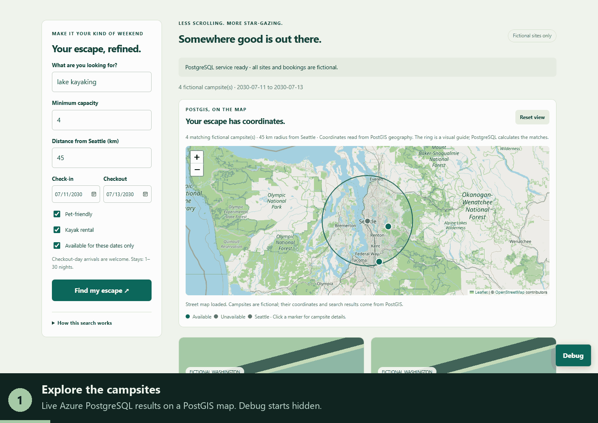

# Find your next escape

A responsive, fictional Washington campsite demo showcasing PostgreSQL geography, full-text search, JSONB, typo tolerance and date-range availability.

## Architecture

See the [dark-mode architecture diagram](../campsites-architecture.svg) for the
container-to-Azure database migration, live app request flow, and PostgreSQL
features. A [1920 x 1080 PNG](../campsites-architecture.png) is ready for slides.

## Live demo

- [Open the campsite app](https://app-campsites-dev-a59e.azurewebsites.net)
- [Open staging](https://app-campsites-dev-a59e-staging.azurewebsites.net)

Both deployments connect to the migrated Azure PostgreSQL database using managed
identity and verified TLS, without a stored database password. Search, typo lookup,
availability, and fictional bookings are enabled. Use demo aliases only, never
personal information. Bookings persist and affect availability in both deployments.

Final deployment checks passed: all 14 tests, including real Azure database
integration; live overlapping-booking rejection and checkout-day arrival; browser
search, typo lookup, booking dialog, and narrow-screen layout. The live booking
smoke test removed only its own uniquely identified test bookings.

## Architecture slide

The static [4K architecture diagram](./campsites-architecture.png) and
[1920 x 1080 version](./campsites-architecture-1080p.png) fit a 16:9 PowerPoint
slide. They show the completed local PostgreSQL dump/restore migration,
Azure PostgreSQL, App Service, browser and map connections, and the PostgreSQL
features used by the app. The diagram is separate from the walkthrough GIF.

## Map and live SQL walkthrough

This 47-second walkthrough uses 12 numbered captions to explain the live map,
search filters, a new fictional booking and its SQL INSERT, the resulting
availability change, misspelled-name lookup, and Debug history. The single demo
reservation created for the recording was removed afterward; existing bookings
were preserved. The final scene holds for 10 seconds with an enlarged typo
lookup: `Lake Samamish Heron` matches `Lake Sammamish Heron`, alongside the
`pg_trgm` SQL and similarity score.



For a full-slide PowerPoint presentation, use the separate
[1920 x 1080 widescreen GIF](./campsites-debug-walkthrough-widescreen.gif).
It is recorded at 16:9, including the numbered caption bar, and keeps the
booking example and a 10-second final misspelled-search scene. Insert it as a
picture on a widescreen slide and size it to the slide without stretching.

The map is part of the normal campsite view. Leaflet is served locally from the
installed package; OpenStreetMap supplies attributed street-map tiles. No map
key or additional Azure resource is required. Tiles require internet access.
If tiles cannot load, the app reports that explicitly instead of fabricating a
basemap; database search, coordinates, and campsite markers remain available.

Markers use `ST_X` / `ST_Y` from the stored PostGIS geography. Changing the search
radius updates both the results and the radius ring around Seattle. The ring is
a visual guide; `ST_DWithin` calculates the actual matches in PostgreSQL. Click
a marker for campsite details and a link to its result card. Zoom, pan, and
**Reset view** are available.

Editing the radius shows a reminder that it has not been applied yet. Click
**Find my escape** to run the search: a highlighted completion message reports
the applied radius, previous radius when changed, match count, and dates.
The SQL sidebar opens automatically for this explicit search, including the
actual radius bound to `$6`. The initial page load and booking availability
refresh do not automatically open Debug.

The SQL sidebar is **hidden on initial load**. Click **Debug** at the bottom right to
open it manually, or click **Find my escape** to open it automatically;
close it with **Close** or Escape. On desktop it sits
on the right without covering the app; on narrow screens it appears above the
search. It shows the last action's SQL, bound parameters, row count, outcome,
and server database-call time. The last eight actions are held only in the page.
Every live action opens and updates Debug automatically. Its **Live action**
section distinguishes instructions, pending operations, completed results, and
errors. Filter edits and map controls explicitly report that no SQL ran;
the SQL shown is still the last completed database operation.
Search and typo lookup update the sidebar. Bookings show the INSERT and any
overlap rejection; the automatic availability refresh does not replace that
booking entry. Booking aliases are redacted.

The API's additive `execution` field uses the same query definitions in
`src/queries.ts` as the PostgreSQL adapter, not a separately maintained sample
query. This is a read-only inspector, not an arbitrary SQL execution endpoint.
Timing includes connection acquisition and is not a database performance benchmark.

## Local development

### Click-through guided demo

Click **Start guided demo** beside **Explore the campsites** to follow a
8-step, presenter-paced walkthrough. Each step states **CLICK/SET/ENTER** and
**EXPECT**, highlights
the next control and explains what to click: map, Debug, filters, radius,
search SQL, booking, availability, typo lookup, and action history.
**Next** and **Back** navigate instructions only; they never submit requests.
**Exit guide** (or **Finish**) returns to the normal app.

The guide has a compact dock with navigation beside the instructions on desktop,
below the scrollable app rather than covering
the map or SQL. While Debug is open, its floating toggle is hidden; use the
sidebar's **Close** button or Escape instead.

The guide moves inside the booking dialog while it is open so its navigation
remains usable above a separately scrollable booking form. Enter a demo alias and explicitly tick the shared-database
confirmation before clicking **Create demo booking**. This confirmation is
required for all bookings, with or without the guide. A successful booking
persists in the shared database and affects availability; exiting or restarting
the guide does not remove it. You can skip the booking steps without saving.
Searches use current data, so counts and available campsites can differ from
the recorded GIF. If there are no available campsites, adjust dates or filters.

Booking requests stop waiting after 20 seconds. If the response times out or
the connection fails, the dialog reports an **unknown outcome** and prevents
resubmission from that form: the reservation may already have saved. Availability
refreshes, but it is not proof of which reservation was saved. Confirm the outcome
before attempting the same booking again; requests are never retried automatically.

After success, the booking dialog closes automatically and Debug displays the
receipt and actual INSERT, with the alias redacted. The guide advances to
**Read the booking result**. Availability refreshes without replacing the INSERT.
The main results area also shows **Your demo bookings this visit**, with each
confirmed campsite name, stay dates, and booking number, independently of Debug
and availability filtering. Receipts accumulate only in the current page;
reloading clears this list but does not delete the persisted database bookings.
It is not an authenticated booking-history or reservation-management feature.
An error leaves the dialog open with its error message; an unknown outcome
must be checked before resubmitting. Guide navigation never submits a booking.

### Run locally

Requires Node.js 24+, npm, and Azure CLI signed in as an authorized database user:

```powershell
npm install
npm run build
Copy-Item .env.sample .env
az login
node --env-file=.env dist/server.js
```

Open `http://localhost:3000`. Optional development command: `npm run dev`.
Production runs compiled Express, not a development server, binding `0.0.0.0` on `PORT` (default 3000).
Node 24 can load a local environment file with `node --env-file=.env dist/server.js`.
Copy `.env.sample` to `.env` if needed; never commit secrets.

The app uses the existing migrated Azure PostgreSQL database, not fabricated results.
The sample configuration uses your Azure CLI identity locally; that identity must
already have database permissions. App Service uses its managed identity instead.
Non-loopback database connections always verify the TLS certificate. Password
authentication without TLS is supported only for a loopback development database.
The app never creates, migrates, resets, or seeds schema.

## API and validation contracts

| Endpoint | Contract |
|---|---|
| `GET /healthz` | Anonymous liveness: `200 {"status":"ok"}`; no dependency check |
| `GET /readyz` | Dependency readiness: `200 {"status":"ready"}` or `503 {"status":"not_ready"}` |
| `GET /api/campsites` | `{campsites:[...]}`; allowlisted public campsite fields only, capped at 100 |
| `GET /api/name-search?name=Lake%20Samamish%20Heron` | `{matches:[{campsite_id,name,similarity}]}`; capped at 3; independent of search filters |
| `POST /api/bookings` | JSON `{campsite_id,guest_alias,check_in,check_out}`; 201 receipt containing only reservation ID, campsite ID and dates |

Search query parameters: `text` (up to 200 characters), `pet_friendly`, `kayak_rental`, `available_only` (literal `true`/`false`), `capacity` (integer 1–20), `radius_km` (1–200), `longitude` (−180–180), `latitude` (−90–90), `check_in`, `check_out`. Unknown/repeated parameters are rejected. False amenity flags mean “do not require this amenity,” not “exclude it.”

Defaults mirror `../sql/03-demo.sql`: `lake kayaking`, pet-friendly and kayak rental required, capacity ≥4, radius 45 km, Seattle (−122.335, 47.608), July 11–13, 2030, available only. Name lookup defaults to intentionally misspelled `Lake Samamish Heron`; the canonical seeded name is `Lake Sammamish Heron`.

Dates must be actual calendar dates in `YYYY-MM-DD`, years 0001–9999. Checkout must follow check-in, at most 30 nights. Stays are **[check-in, checkout)**, permitting checkout-day arrivals. Historical demo dates are intentionally not forbidden.
Booking IDs must be positive PostgreSQL integer campsite IDs. Aliases are trimmed, 1–60 characters, letters/numbers/spaces/underscores/hyphens only. The UI explicitly requests an alias, not a personal name; software cannot prove an alias is not a real name.

Invalid input returns 400; origin failure 403; missing campsite 404; overlapping booking 409; oversized JSON 413; non-JSON 415; rate limiting 429; repository unavailable 503; unexpected errors 500. Public 500/503 messages and event-only logs omit exception details and credentials.

## PostgreSQL implementation

`src/postgres.ts` implements the `CampsiteRepository` contract in
`src/repository.ts`. `src/server.ts` constructs the connection pool and adapter.
Queries are parameterized; date ranges and the database exclusion constraint
arbitrate booking conflicts atomically. Reservation IDs remain strings to
preserve PostgreSQL bigint precision.

Required environment variables are `PGHOST`, `PGUSER`, and `PGDATABASE`.
`PGPORT` defaults to 5432, `DB_AUTH` to `entra`, and `AZURE_AUTH_MODE` to
`managed-identity`. Local Azure development explicitly uses `AZURE_AUTH_MODE=cli`.
Entra tokens are acquired for new connections rather than stored as a fixed
password; pooled connections recycle after ten minutes. The pool is capped at
eight connections, with connection, statement and lock timeouts.

- `ready()` checks both existing tables.
- `search()` combines full-text search, JSONB, geography, capacity, and reservation availability.
- `searchNames()` uses `%` and `similarity()` from `pg_trgm`.
- `book()` inserts the selected date range; SQLSTATE `23P01` becomes HTTP 409.
- The web app's database role can read campsite details and reservation IDs/site IDs/dates,
  insert bookings, and use the reservation sequence. It cannot select guest names,
  delete/update bookings, administer roles, or reset schema.

## Security and operational boundaries

Helmet CSP permits only local scripts/styles/connects, with no inline scripts.
Images additionally allow the exact OpenStreetMap tile host and Leaflet's data-URI
images. The browser sends only an origin referrer to cross-origin tile requests.
Dynamic application strings use `textContent`; no user-controlled HTML
interpolation is used. CORS deliberately grants no cross-origin access. POST
requires an exact `Origin` match and rejects cross-site Fetch Metadata;
non-browser clients must explicitly send the configured origin too.

Set `PUBLIC_ORIGIN` to the canonical browser origin for reverse-proxy/HTTPS deployments.
The Azure configuration derives it from each slot's actual hostname and pins it
to that slot. App Service trusts its immediate ingress proxy; local development
does not trust forwarded headers. Do not expose a proxy-configured server directly.

API reads share a 120/minute per-IP limit; writes have a separate 10/minute per-IP limit, before JSON parsing (8 KiB cap). Limits are process-local and bounded to 10,000 active clients; restart resets them. Multiple replicas require a shared limiter or gateway, and proxy-aware client IP handling needs explicit configuration. Health endpoints are excluded. Public writes are fictional-demo-only, not authenticated production reservations.

## Validation gate

```powershell
npm run typecheck
npm run build
npm test
```

Tests use `node:test`, `tsx` and `supertest`; fixtures are test-only and never used at runtime. They cover calendar validity, filter bounds, invalid requests, repository forwarding, privacy allowlists, successful booking, conflict/error translation, readiness, origin/JSON guards, body size and read/write limits.

The real database integration test is opt-in:

```powershell
$env:PGHOST = 'bobward-campsites-pg18.postgres.database.azure.com'
$env:PGUSER = 'bobward@microsoft.com'
$env:PGDATABASE = 'campsites'
$env:DB_AUTH = 'entra'
$env:AZURE_AUTH_MODE = 'cli'
$env:INTEGRATION_POSTGRES = '1'
npm test
```

It checks six combined search matches, typo matching, booking conflicts,
adjacent stays, availability, and privacy. Test bookings are rolled back;
PostgreSQL identity sequences can advance despite rollback.

## Azure deployment

Infrastructure is in `infra/main.bicep`: a Premium P1v3 Linux plan, Node.js 24
web app, and staging slot in the existing `campsites-demo-rg` in Central US.
Both use HTTPS, always-on, health checks, disabled FTP/basic publishing
credentials, and independent system-assigned identities. The slot shares the
same compute plan and the same demo database; it is not a data-isolated test
environment. One compute instance is not a highly available production design.

After deployment authorization, build the app and execute:

```powershell
npm run build
.\scripts\deploy.ps1 -Provision
```

Requires PowerShell 7, Azure CLI/Bicep, Node.js, permission to provision App Service,
and an Entra database administrator identity. The script creates the approved app
resources, grants scoped database access, packages source without secrets, deploys
through Entra-authenticated Kudu zipdeploy, and verifies staging before production.
Without `-Provision`, it reuses the recorded ARM deployment and redeploys code.
No database password, schema reset, seed operation, or firewall update is performed.

For an existing deployment, validate staging before publishing to production:

```powershell
.\scripts\deploy.ps1 -StagingOnly
# Check the staging map and Debug sidebar, then publish both slots:
.\scripts\deploy.ps1
```

The deployment gate waits for the expected browser-script hash and new SQL
execution details, rather than accepting a still-running previous release's
readiness response. It also checks PostGIS coordinates and local map-library assets.

`scripts/grant-database-access.mjs` binds role names to the exact managed identity
object IDs and refuses to replace conflicting existing mappings. `PGUSER` and
`PUBLIC_ORIGIN` are slot-sticky, so a future code swap does not swap identities.

`scripts/smoke-bookings.mjs <https-app-origin>` exercises simultaneous public
bookings, expects one success and one conflict, checks an adjacent stay and
availability, and removes only its own uniquely identified test bookings using
an authorized administrator connection. Obtain permission for these writes
before running it. Never expose administrative cleanup as a public endpoint.

Deleting the shared resource group would also delete the migrated database.
For app-only cleanup, delete the named web app and its plan explicitly instead.
